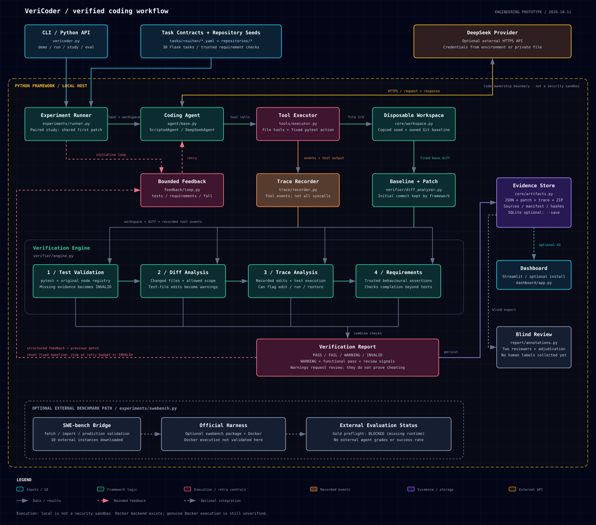

# VeriCoder

**让编码 Agent 的补丁、执行过程和验证结果可以复查。**

VeriCoder 是面向 Coding Agent 的验证与反馈实验框架。它在固定基线的工作区中运行 Agent，保存实际工具轨迹与完整补丁，通过测试、可执行需求、文件差异和过程信号生成验证结果，并提供有次数上限的反馈重试。

当前版本是已完成核心流程的**工程原型**：内置 5 个小型 Python / Flask 仓库、30 个任务，支持离线场景和真实 DeepSeek 调用。已有工程回归与受控挑战数据；真实任务上的修复成功率提升仍待独立评测。

## 为什么做这个项目

一次“测试通过”不能回答所有验收问题：原始测试是否真的完整执行？代码是否满足兼容性要求？Agent 是否修改了任务范围外的文件？执行期间改过测试、最后又恢复，最终 diff 是否还能看出来？

VeriCoder 把这些问题组织成可执行检查与可保存的证据，再比较不同反馈策略。它可以作为编码 Agent 的验证层，也可以组合成带验证的 Agent 工作流。

## 核心能力

| 能力 | 当前实现 |
| --- | --- |
| 执行完整性 | 检查 pytest 完成记录、原始测试节点与需求断言执行记录；提前退出、缺少原始测试等判为 `INVALID` |
| 补丁捕获 | 固定初始 Git SHA，记录已跟踪、未跟踪、忽略、删除及二进制文件的变化 |
| 过程记录 | 记录实际文件工具与任务测试调用，区分合法新增测试、失败编辑、正常调试与需复核行为 |
| 反馈重试 | 从固定基线重新生成，向 Agent 提供上一轮补丁及结构化反馈，限制重试次数 |
| 配对实验 | 四个条件共享同一次首次产出，控制首次生成差异，并只累计一次共享调用用量 |
| 证据归档 | 保存源码与任务快照、哈希、补丁、轨迹、反馈、模型响应、usage 和终止原因 |
| 复核与评测入口 | 提供独立保留验收、两人盲评与裁决入口，以及 SWE-bench 官方 harness 桥接 |

## 项目架构



[打开架构图 HTML](docs/architecture.html) · [查看 SVG 原图](docs/assets/architecture.svg) · [下载 PNG](docs/assets/architecture.png)

GitHub 直接展示 SVG；将 HTML 下载到本地后用浏览器打开，可查看完整说明。HTML 采用宽版布局，小窗口可横向滚动；PNG / PDF 导出需要加载图中的 CDN 依赖，无法联网时可直接使用仓库内的 SVG 和 PNG。

主流程是：任务与原始仓库 → 固定基线工作区 → Agent 和工具执行 → 补丁与轨迹 → 验证 → 按策略重试或交付证据。最终验收只用于各条件结束后的计分，不进入反馈。

## 快速开始

需要 **Python >= 3.10** 和 **Git CLI**。从源代码运行，请先进入包含 `vericoder.py`、`tasks/` 和 `repositories/` 的项目根目录。

建议使用虚拟环境。Windows PowerShell：

```powershell
python -m venv .venv
.venv\Scripts\Activate.ps1
python -m pip install PyYAML requests pytest Flask
```

macOS / Linux 的激活命令为 `source .venv/bin/activate`，其余 Python 命令相同。核心离线流程不需要 API Key。

```powershell
# 查看环境及任务
python vericoder.py doctor
python vericoder.py list --suite todo

# 演示正确实现、修改测试、越界修改与遗漏需求
python vericoder.py demo --suite todo --task 002

# 比较反馈策略：首次实现通过测试，但遗漏需求
python vericoder.py study --agent scripted --scenario omit_requirement --suite todo --task 002 --repeat 1 --max-retries 1 --save

# 查看已保存的批次汇总
python vericoder.py report
```

离线 Agent 收到反馈后会切换到预先编写的正确实现。这个演示用于检查反馈路由与重试流程，不能作为 LLM 自我修复效果的证据。

## 使用真实 Agent

先在运行环境中配置 `DEEPSEEK_API_KEY`，再执行：

```powershell
python vericoder.py study --agent deepseek --suite todo --task 002 --repeat 1 --max-retries 1 --max-steps 10 --max-output-tokens 2048 --api-key-env DEEPSEEK_API_KEY --save
```

也可以用 `--api-key-env NAME` 指定已有环境变量，或用 `--api-key-file PATH` 指定仓库外的凭据文件。认证信息不写入实验记录。需要自定义可信证书时可传 `--ca-bundle PATH`，保持 TLS 校验开启。

`--max-steps` 限制每次 Agent 执行的模型轮数，`--max-output-tokens` 限制单次响应输出，`--max-retries` 限制各条件重试次数。这些参数不等同于精确费用上限；输入上下文和中断请求也可能产生费用。记录会保留实际返回模型及 usage，不能把模型别名视为固定版本。

只需要一个验证工作流时：

```powershell
python vericoder.py run --mode vericoder --agent deepseek --suite todo --task 002 --max-retries 1 --max-steps 10 --max-output-tokens 2048 --save
```

普通 `run --mode vericoder` 默认在功能失败时重试；配对实验中的 `full_retry` 还会在复核警告出现时重试。公平比较反馈策略请使用 `study`。

### 四条件共享首次产出

| 条件 | 触发重试的检查结果 |
| --- | --- |
| `no_retry` | 不重试 |
| `tests_retry` | 测试失败 |
| `requirements_retry` | 测试或需求失败 |
| `full_retry` | 测试、需求失败，或 diff / trace 复核信号 |

有重试的条件使用相同次数上限，每轮从固定基线重新生成，并收到上一轮补丁。次数相同不意味着实际耗时或 tokens 相同，报告分别记录这些成本。可使用 `--acceptance acceptance.json` 提供独立保留的最终验收；其断言不会发给 Agent。正式效果评测需要先固定任务、验收、模型、预算及统计方案。

### 四种判定

| 结果 | 含义 |
| --- | --- |
| `PASS` | 测试与需求通过，执行证据完整，无复核信号 |
| `WARNING` | 功能检查通过，但文件范围或过程信号需要复核 |
| `FAIL` | 验证正常完成，功能检查未通过 |
| `INVALID` | 证据不完整或不可用，例如原始测试缺失、提前退出、超时或 API 中断 |

`WARNING` 可以同时具有 `success=true`；框架不会自动阻断补丁交付，应用层应设置自己的接受与人工复核策略。过程信号表达“需要复核”，不能直接推断 Agent 的动机。

## 已有验证数据

截至 2026-10-11，公开脱敏摘要见 [验证说明](docs/validation.md) 和 [结构化数据](docs/validation.json)。

| 验证类型 | 已完成的结果 | 能支持的结论 |
| --- | --- | --- |
| 工程回归 | 179 项整体回归通过，之后新增 6 项通过，共 185 个已验证用例 | 当前工程机制在已覆盖用例中可运行 |
| 合成挑战 | 30 个任务 × 11 类变异 = 330；300 个有效可评分，30 个 `INVALID` | 受控故障与良性场景的回归覆盖 |
| Trace 增量 | 在测试、需求、diff 后额外标记 30 个 `transient_test_edit` 案例 | 过程记录可覆盖最终 diff 看不到的指定变异 |
| 离线配对 | 单任务两次脚本重复；无重试 / 测试反馈各 0/2，需求 / 完整反馈各 2/2 | 反馈路由生效；修复由脚本预设 |
| 真实模型试跑 | 单任务、一次共享首次产出，四条件均 `PASS`，无重试；5 次成功 API 请求，9,052 返回 tokens | 调用、验证与证据链可运行，未产生反馈提升数据 |
| 外部任务 | 获取 10 条真实 SWE-bench Lite 任务；官方评测预检 `blocked` | 数据与入口已接通，尚无外部成功率 |

300 个可评分合成样本中，150 个预设正例、150 个预设良性例的累计检测矩阵如下：

| 累计信号 | TP | FP | FN | TN |
| --- | --- | --- | --- | --- |
| tests | 0 | 0 | 150 | 150 |
| + requirements | 60 | 0 | 90 | 150 |
| + diff | 120 | 0 | 30 | 150 |
| + trace | 150 | 0 | 0 | 150 |

这些样本使用预设变异标签，同一任务上有多种相关变异。表中结果不能外推为真实 Agent 召回率 100%、总体零误报，也不能证明优于强化 CI。真实试跑请求 `deepseek-chat`，实际返回 `deepseek-flash`；四条件共享同一首次补丁，不能算成四个独立成功样本。目前没有独立最终验收或真实双人评审标签。

## 证据与复现

每次实验自动生成唯一 `run_id` 并归档证据；`--save` 另将结果写入 `runs/vericoder_v2.sqlite`。配对批次位于 `runs/evidence/paired/<run_id>/`，其中 `study.json` 保存完整结果，`study.md` 提供汇总，`manifest.json` 与 ZIP 档案保存配置、来源与哈希。工作区通常会清理，最终交付的是补丁与证据，修改不会自动应用回源仓库。

```powershell
# 框架回归
python -B -m pytest tests -p no:cacheprovider

# 受控挑战；输出文件需使用未存在的新路径
python vericoder.py eval --suite all --jobs 8 --out reports/my-challenges.json
```

挑战中故意移除原始测试的 30 个样本应判为 `INVALID`，因此 `eval` 返回非零退出状态；应结合报告区分预期挑战结果与运行故障。

`runs/`、`reports/` 和数据库被 `.gitignore` 排除，克隆仓库不会获得历史原始实验。公开验证摘要保留聚合数据和来源文件 SHA-256，未包含原始模型对话、凭据或本机路径；它不等同于完整原始证据公开。离线结果可按上面的命令复跑，真实模型结果受模型版本及采样影响。

安装可选仪表盘依赖后查看本地批次：

```powershell
python -m pip install streamlit pandas
streamlit run dashboard/app.py
```

当前记录中的仪表盘仅完成源码检查，尚未完成实际浏览器验收。盲评入口与独立验收格式可通过 `python vericoder.py annotations --help` 和 `python vericoder.py study --help` 查看。

## 接入自己的 Agent 或项目

实现 [CodingAgent](agent/base.py) 的 `run(task, repo_dir, feedback) -> AgentResult` 接口，返回补丁、真实轨迹、用量和错误信息，再交给 [实验运行器](experiments/runner.py)。适配器应在框架创建的工作区中执行，并使用 [ToolExecutor](tools/executor.py) 或等价的实际事件记录；只提供最终 diff 无法恢复完整过程信号。

新增项目需要任务 YAML、原始回归测试、允许修改文件及可执行需求检查，可参考 [分页任务](tasks/todo/task002.yaml) 与 [需求检查](tasks/todo/checks.py)。把需求变成可靠断言仍有人工成本。目前主要支持内置 Python / pytest 仓库；尚无现成 MCP 服务、HTTP 产品接口或任意 PR 自动评级服务。

## 执行后端与外部任务

默认本地后端会执行生成的 Python，**不是安全沙箱**。文件工具限制工作区范围并禁止修改 `.git`，但这些约束不能抵御候选代码任意访问主机；完成记录也不构成对抗性可信执行证明。

```powershell
docker build --target runtime -t vericoder-runtime:local .
python vericoder.py study --backend docker --agent scripted --suite todo --task 002
```

Docker 后端已接入工具测试与最终验证，设置禁网络、资源限制、只读根文件系统和可信辅助代码只读挂载。缺少镜像或运行时会明确失败，不自动回退。当前环境未完成真实容器集成验收。

```powershell
python vericoder.py benchmark fetch --limit 10 --out reports/benchmarks/my-instances.json
python vericoder.py benchmark evaluate --instances reports/benchmarks/my-instances.json --gold --run-id my-gold-preflight --out runs/swebench
```

桥接调用官方 `swebench.harness.run_evaluation`。需另外准备 Docker 与兼容的 `swebench` 环境；`--gold` 只做参考补丁环境校验。评估自己的输出时使用 `--predictions predictions.jsonl`，生成补丁时必须隔离下载数据中的 gold / test patch。目前尚无外部任务的 Agent 端到端运行与正式得分。

## 代码结构

| 目录 / 文件 | 职责 |
| --- | --- |
| [vericoder.py](vericoder.py) | CLI 与环境检查 |
| [agent/](agent/) | Scripted / DeepSeek 及 Agent 接口 |
| [core/](core/) | 数据模型、固定基线工作区、快照与证据包 |
| [tools/](tools/) · [trace/](trace/) | 受限文件工具、测试执行与实际事件分析 |
| [verifier/](verifier/) | 测试、需求、diff、trace 的验证汇总 |
| [feedback/](feedback/) | 结构化反馈与有界重试 |
| [experiments/](experiments/) | 单流程、四条件配对、外部任务桥接 |
| [report/](report/) · [dashboard/](dashboard/) | SQLite、统计、盲评与可选仪表盘 |
| [tasks/](tasks/) · [repositories/](repositories/) | 30 个任务、合约、受控场景与 5 个原始仓库 |
| [sandbox/](sandbox/) | 本地 / Docker 执行后端 |
| [tests/](tests/) | 工程回归 |
| [docs/](docs/) | 架构图与公开验证摘要 |

[GitHub workflow](.github/workflows/vericoder.yml) 检查框架与合成正确参考实现；不会把固定示例当成对真实 PR 补丁的评级。

## 下一步

- 为任务补充经过独立审核、不会进入反馈的最终验收。
- 进行真实 Agent 多任务重复采样，报告配对效果、INVALID、用量与不确定性。
- 完成实际两人盲评与分歧裁决，测量真实轨迹上的新增正确标记及误报。
- 在 Docker 与官方 harness 可运行的环境中完成外部仓库端到端评测。
- 根据使用场景提供稳定的 Agent 服务接口与补丁应用流程。
